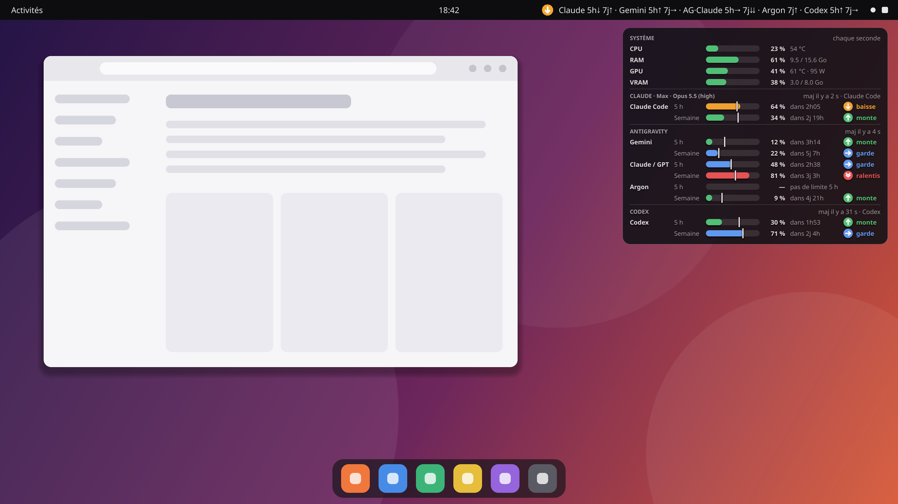
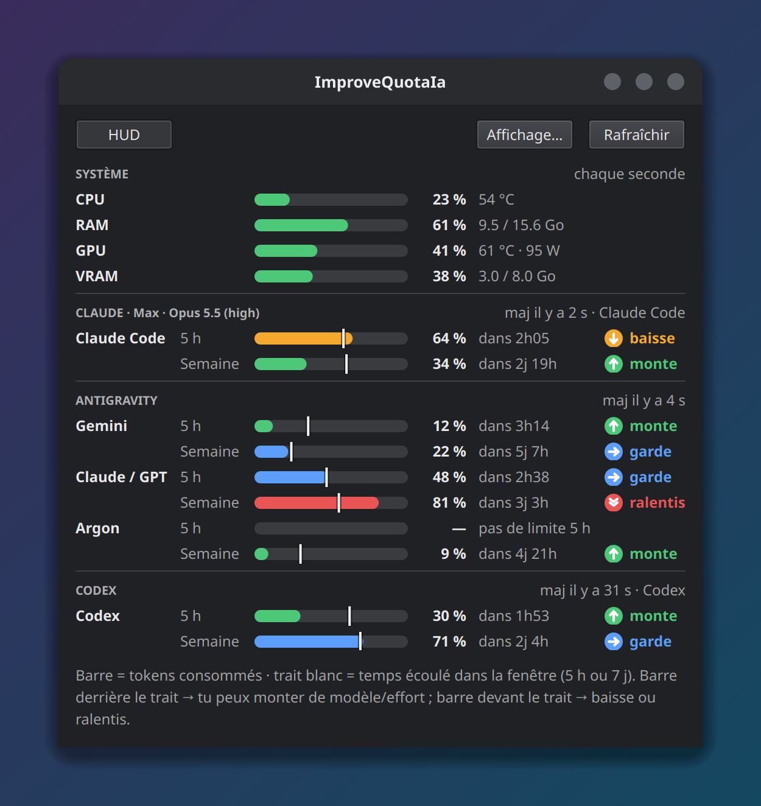

<div align="center">

# ImproveQuotaIa

**Je peux passer sur un modèle plus gros, ou je dois ralentir ?**
Le rythme de tes quotas d'IA en direct, dans ta barre du haut et dans un HUD translucide.

[](LICENSE)
[](https://www.python.org/)
[](#installation)
[](https://ko-fi.com/Maxft68)

[English version](README.md)



</div>

ImproveQuotaIa compare **la part de chaque quota déjà consommée** à **la part du temps écoulée dans sa fenêtre**
(5 heures, 7 jours…). Pour chaque fenêtre, il te dit si tu peux **monter** de modèle ou d'effort, **garder** ton rythme,
**baisser** ou **ralentir**, avec CPU / GPU / RAM à côté.

> [!NOTE]
> **Pour l'instant, ImproveQuotaIa n'a été testé qu'avec Claude Code et Antigravity**, sous Linux (Ubuntu, GNOME). Les
> autres outils (Codex, Grok, GitHub Copilot, Gemini CLI, GLM) ainsi que macOS et Windows sont pris en charge mais pas
> encore vérifiés : j'attends les retours des utilisateurs pour confirmer leur bon fonctionnement. Si tu utilises l'un
> d'eux, dis-moi ce que ça donne dans les [issues](https://github.com/Maxft68/ImproveQuotaIa/issues).

## Comment lire les conseils

La barre = part du quota consommée ; le trait blanc = part de la fenêtre déjà écoulée.

| Conseil | Quand | Que faire |
|---|---|---|
| ↑ **monte** | barre au moins 5 points derrière le trait | tu as de la marge : modèle plus gros ou effort plus élevé |
| → **garde** | barre entre 5 points derrière et 3 points devant | rythme tenable : ne change rien |
| ↓ **baisse** | barre 3 à 10 points devant le trait | passe à un modèle plus léger ou baisse l'effort |
| ⇊ **ralentis** | barre plus de 10 points devant | modèle léger, effort bas, ou fais une pause |
| ✕ **épuisé** | plus rien | attends la réinitialisation (le compte à rebours est affiché) |

En fin de fenêtre (moins de 15 % du temps restant), s'il reste au moins 1,5× plus de quota que de temps, le conseil est
**monte**, pour ne pas gaspiller le quota.

## Fonctionnalités

- **Un conseil par fenêtre** : les fenêtres 5 h et hebdomadaire sont jugées séparément, dans tous les affichages.
- **Texte dans la barre du haut** (Linux), par exemple `Claude 5h↓ 7j↑ · Gemini 5h↑ 7j→`, avec un menu détaillé ; une
  icône colorée sous macOS et Windows.
- **HUD translucide** : toujours au premier plan, traversé par les clics, il s'efface quand la souris approche et se
  cache pendant un jeu ou une vidéo en plein écran.
- **Fenêtre détaillée** avec tous les quotas, les comptes à rebours et l'utilisation du système :

  

- **Assistant de premier lancement** : on coche les outils utilisés (ceux trouvés sur l'ordinateur sont déjà cochés), et
  c'est fini. Ensuite tout démarre avec ta session ; tu changes ce que tu veux dans *Affichage et réglages*.
- **Sélecteur d'affichage** : choisis ce que montrent le HUD, la barre du haut et la fenêtre (CPU, RAM, GPU, VRAM,
  chaque outil, chaque fenêtre).
- **Aucune clé API, rien envoyé à un tiers** : ImproveQuotaIa réutilise les connexions déjà présentes sur l'ordinateur.
- Raccourcis dans le menu et sur le bureau, démarrage avec la session (au choix), interface en français et en anglais.

## Outils pris en charge

| Outil | Fenêtres | Source |
|---|---|---|
| **Claude Code** (Pro / Max) | 5 h, 7 j (+ Opus / Sonnet si fournis) | barre d'état de Claude Code (en direct) + l'interface utilisée par `/usage` (toutes les 5 min) |
| **Antigravity CLI** (Gemini, Argon, Claude / GPT) | 5 h, 7 j | `agy -p /usage --output-format json` (ne consomme pas de quota) |
| **Codex CLI** (abonnements ChatGPT) — *expérimental* | 5 h, 7 j | évènements `rate_limits` dans `~/.codex/sessions/**/rollout-*.jsonl` |
| **Grok Build** (SuperGrok) — *expérimental* | pool hebdomadaire | jeton de `grok login` (`~/.grok/auth.json`) + interface de facturation du CLI Grok |
| **GitHub Copilot** — *expérimental* | requêtes premium, par mois | jeton GitHub (fichiers de Copilot, `gh auth token`, variables d'environnement) + `copilot_internal/user` |
| **Gemini CLI** (comptes Code Assist entreprise) — *expérimental* | par jour, par famille de modèles | `~/.gemini/oauth_creds.json` + `retrieveUserQuota` |
| **GLM Coding Plan (z.ai)** — *expérimental* | 5 h (+ semaine selon l'offre) | `Z_AI_API_KEY`, ou la clé z.ai déjà configurée dans Claude Code (`ANTHROPIC_BASE_URL` + `ANTHROPIC_AUTH_TOKEN`) |

*Expérimental* = écrit d'après des formats documentés, pas encore testé avec un vrai compte (seuls Claude Code et
Antigravity l'ont été) : j'attends les retours des utilisateurs pour confirmer leur bon fonctionnement, à signaler dans
les [issues](https://github.com/Maxft68/ImproveQuotaIa/issues).

Pas encore pris en charge : les outils dont l'usage ne se lit que par les cookies du navigateur ou des bases locales non
documentées (Cursor, Kimi, Windsurf, Amp, Factory…), et les clés API payées à l'usage (pas de fenêtre 5 h / 7 j). Un autre
outil ? Voir [Ajouter un outil](#ajouter-un-outil).

## Installation

**Avec Python 3.9+** (Linux, macOS, Windows) :

```bash
pipx install git+https://github.com/Maxft68/ImproveQuotaIa
improvequotaia
```

Depuis les sources :

```bash
git clone https://github.com/Maxft68/ImproveQuotaIa && cd ImproveQuotaIa
python -m pip install -e .
python -m improvequotaia
```

**Exécutables autonomes** (sans Python) : ils seront disponibles sur la page [Releases](../../releases) dès la première
version.

## Au quotidien

1. **Premier lancement** : l'assistant s'ouvre une seule fois. Coche tes outils et tes options (HUD, démarrage avec
   l'ordinateur, raccourcis menu et bureau, quotas Claude en direct), puis clique sur **Terminer**.
2. **À chaque session ensuite** : ImproveQuotaIa démarre en arrière-plan avec le texte de la barre du haut et le HUD.
   Aucune fenêtre ne s'ouvre.
3. **Pour changer quelque chose** : clique sur le texte de la barre du haut (ou l'icône) → **Affichage et réglages…**,
   ou ouvre l'application depuis son raccourci du menu ou du bureau.

Les réglages ont quatre onglets : *Affichage* (ce que montre chaque vue), *Outils*, *Général* (langue, démarrage,
raccourcis, position et opacité du HUD) et *À propos*.

## Fonctionnement

| Donnée | Provenance |
|---|---|
| CPU / RAM | `psutil` |
| GPU | `nvidia-smi` (NVIDIA, Linux/Windows), sysfs (AMD, Linux), `ioreg` (Apple, macOS), compteurs de performance (autres cartes, Windows) |
| Claude Code | Claude Code transmet `rate_limits` à sa barre d'état à chaque message ; celle d'ImproveQuotaIa les enregistre localement. Toutes les 5 minutes, ImproveQuotaIa interroge aussi le serveur d'Anthropic avec la connexion enregistrée par Claude Code (`~/.claude/.credentials.json`, ou le trousseau macOS), ce qui compte aussi l'usage de claude.ai. |
| Antigravity | lance ta propre commande `agy`, déjà connectée |
| Codex, Grok, Copilot, Gemini CLI, z.ai | les connexions ou fichiers de session que ces outils gardent déjà sur ton ordinateur (voir le tableau ci-dessus) |

Tes identifiants ne quittent jamais l'ordinateur, sauf vers le serveur du fournisseur lui-même. **Quotas Claude en
direct** est une option (cochée par défaut dans l'assistant, ou *Réglages → Outils*) : ImproveQuotaIa règle lui-même la
barre d'état de Claude Code, rien à modifier à la main. `~/.claude/settings.json` est sauvegardé avant, et une barre
d'état que tu avais déjà est conservée et reste affichée. Sans cette option, les quotas Claude sont relevés toutes les
5 minutes.

## Questions fréquentes

**Dois-je saisir une clé API ?** Non. ImproveQuotaIa réutilise seulement les connexions des outils que tu utilises déjà.

**Est-ce que ça consomme mon quota ?** Non. Il lit les chiffres d'utilisation, il n'envoie jamais de requête au modèle.
`agy /usage` et la barre d'état de Claude sont gratuites.

**Gemini CLI ou Antigravity ?** Deux outils Google différents. Les abonnés Google AI Pro / Ultra ont leurs quotas Gemini
5 h / semaine dans **Antigravity** ; les quotas de Gemini CLI ne sont fournis qu'aux comptes Code Assist entreprise.

**Mes données partent-elles quelque part ?** Non. Rien n'est envoyé ailleurs qu'aux serveurs des fournisseurs eux-mêmes,
et il n'y a aucune télémétrie.

## Notes par système

- **Linux** : le texte de la barre du haut utilise AppIndicator via le Python du système (sous Debian/Ubuntu :
  `sudo apt install python3-gi gir1.2-ayatanaappindicator3-0.1` s'il manque) ; sinon une icône colorée s'affiche à la
  place. Sous GNOME, l'extension AppIndicator est nécessaire (active par défaut sur Ubuntu). Sous Wayland, le HUD passe
  par XWayland pour rester au premier plan.
- **macOS** : la première lecture des identifiants Claude peut afficher une demande du trousseau (« Toujours
  autoriser »).
- **Windows** : le HUD se cache automatiquement pendant les jeux et présentations en plein écran.

## Ajouter un outil

Crée `src/improvequotaia/providers/<outil>.py` avec une sous-classe de `Provider` qui implémente `detect()` (l'outil
est-il installé ?) et `fetch()` (renvoie un `ProviderResult` avec un `Bucket` par fenêtre de quota : part consommée, date
de réinitialisation, durée de la fenêtre), puis ajoute-la à `ALL_PROVIDERS` dans `providers/__init__.py`. Les conseils,
les affichages et les réglages suivent automatiquement. Ajoute un test avec un exemple de la vraie sortie de l'outil.

```bash
python -m pip install -e ".[dev]" && python -m pytest
python scripts/screenshots.py   # régénère les images du README (données fictives)
```

Les pull requests sont désactivées sur ce dépôt : le code est maintenu uniquement par son auteur. Pour signaler un
problème ou proposer un outil, [ouvre une issue](https://github.com/Maxft68/ImproveQuotaIa/issues).

## Soutenir le projet

ImproveQuotaIa est gratuit. S'il t'aide à mieux utiliser tes quotas, tu peux
[m'offrir un chocolat chaud sur Ko-fi](https://ko-fi.com/Maxft68) (sans inscription, par carte ou PayPal). Le lien est
aussi dans *Réglages → À propos*.

## Avertissement

ImproveQuotaIa est un projet indépendant, sans lien avec Anthropic, Google, OpenAI, xAI, GitHub, Microsoft ou Z.ai, ni
approuvé par eux. Il lit des fichiers locaux et des interfaces qui ne sont pas toutes documentées officiellement : elles
peuvent changer et casser la section d'un outil. Les captures d'écran utilisent des données fictives.

## Licence

ImproveQuotaIa est un logiciel libre, Copyright (C) 2026 [Maxft68](https://github.com/Maxft68), distribué sous licence [GNU General Public License v3.0 ou
ultérieure](LICENSE) (GPL-3.0-or-later) : tu peux le redistribuer et le modifier selon ces termes, et toute version
dérivée distribuée doit rester sous GPL, avec son code source.

**Licence commerciale / propriétaire** : toute revente commerciale, redistribution d'ImproveQuotaIa (ou d'une version
modifiée) sous forme de logiciel propriétaire à code fermé, ou intégration dans un produit commercial sans respecter les
obligations de la GPLv3 est strictement interdite sans l'achat préalable d'une licence commerciale auprès de l'auteur —
me contacter sur [LinkedIn](https://www.linkedin.com/in/maxime-dsiurdsi-5b3b2b226/).

Les exécutables autonomes publiés sur la page Releases embarquent [PySide6 / Qt](https://www.qt.io/qt-licensing),
distribués sous licence [LGPLv3](https://www.gnu.org/licenses/lgpl-3.0.html) : leurs bibliothèques partagées restent
des fichiers séparés dans l'archive et peuvent être remplacées. Voir [THIRD_PARTY_LICENSES](THIRD_PARTY_LICENSES),
également inclus dans les exécutables.
