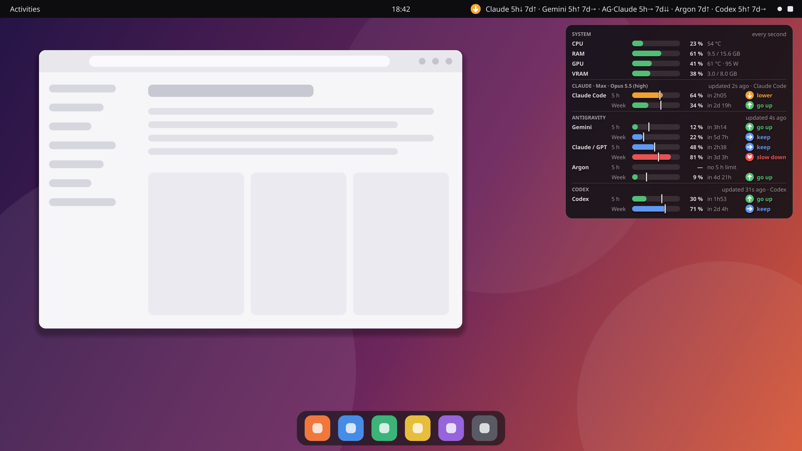
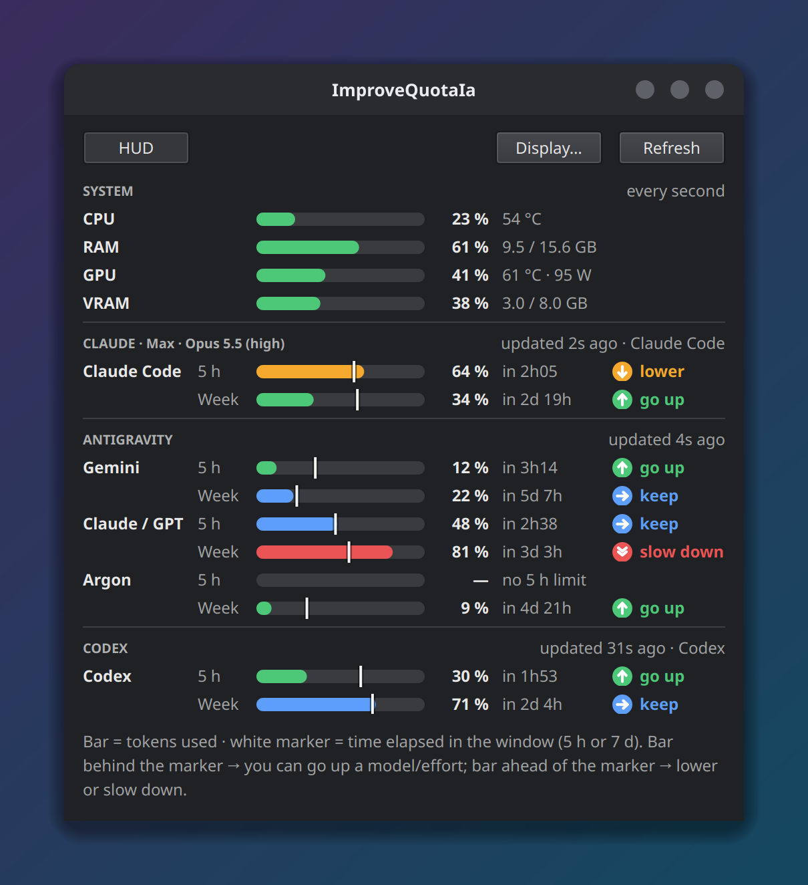

<div align="center">

# ImproveQuotaIa

**Should I switch to a bigger model, or slow down?**
Live pace advice for your AI coding quotas, right in your top bar and in a translucent HUD.

[](LICENSE)
[](https://www.python.org/)
[](#install)
[](https://ko-fi.com/Maxft68)

[Version française](README.fr.md)



</div>

ImproveQuotaIa compares **how much of each quota you have used** with **how much of its window has elapsed**
(5 hours, 7 days…). For every window it tells you whether you can **go up** to a bigger model or more effort, **keep**
your pace, **lower**, or **slow down**, and shows CPU / GPU / RAM alongside.

> [!NOTE]
> **So far, ImproveQuotaIa has only been tested with Claude Code and Antigravity**, on Linux (Ubuntu, GNOME). The other
> tools (Codex, Grok, GitHub Copilot, Gemini CLI, GLM) and macOS / Windows are implemented but not verified yet: I am
> waiting for user feedback to confirm they work. If you use one of them, please tell me how it goes in the
> [issues](https://github.com/Maxft68/ImproveQuotaIa/issues).

## How to read it

The bar is the share of the quota you have used; the white marker is the share of the window that has elapsed.

| Advice | When | What to do |
|---|---|---|
| ↑ **go up** | bar at least 5 points behind the marker | you have room: bigger model or more effort |
| → **keep** | bar between 5 points behind and 3 points ahead | sustainable pace: change nothing |
| ↓ **lower** | bar 3 to 10 points ahead of the marker | switch to a lighter model or lower effort |
| ⇊ **slow down** | bar more than 10 points ahead | light model, low effort, or take a break |
| ✕ **used up** | nothing left | wait for the reset (the countdown is shown) |

Near the end of a window (less than 15 % of the time left), if at least 1.5× more quota than time remains, the advice is
**go up**, so the quota is not wasted.

## Features

- **Advice for each window**: 5-hour and weekly windows are judged separately, in every view.
- **Top-bar text** (Linux), e.g. `Claude 5h↓ 7d↑ · Gemini 5h↑ 7d→`, with a detailed menu; a coloured tray icon on macOS
  and Windows.
- **Translucent HUD**: always on top, clicks go through it, fades when the mouse comes near, hides while a game or a
  video is fullscreen.
- **Detailed window** with every quota, reset countdowns and system usage:

  

- **First-run wizard**: tick the tools you use (the ones found on your computer are already ticked), and you are done.
  Then everything starts with your session; change anything later in *Display & settings*.
- **Display picker**: choose what the HUD, the top bar and the window show (CPU, RAM, GPU, VRAM, each tool, each
  window).
- **No API key, nothing sent to third parties**: ImproveQuotaIa reuses the sign-ins already on your computer.
- Menu and desktop shortcuts, start with your session (optional), English and French interface.

## Supported tools

| Tool | Windows shown | Source |
|---|---|---|
| **Claude Code** (Pro / Max) | 5 h, 7 d (+ Opus / Sonnet when reported) | Claude Code status line (live) + the usage endpoint behind `/usage` (every 5 min) |
| **Antigravity CLI** (Gemini, Argon, Claude / GPT) | 5 h, 7 d | `agy -p /usage --output-format json` (uses no quota) |
| **Codex CLI** (ChatGPT plans) — *experimental* | 5 h, 7 d | `rate_limits` events in `~/.codex/sessions/**/rollout-*.jsonl` |
| **Grok Build** (SuperGrok) — *experimental* | weekly pool | token from `grok login` (`~/.grok/auth.json`) + Grok CLI billing endpoint |
| **GitHub Copilot** — *experimental* | premium requests, monthly | GitHub token (Copilot config files, `gh auth token`, env) + `copilot_internal/user` |
| **Gemini CLI** (Code Assist business accounts) — *experimental* | daily, per model family | `~/.gemini/oauth_creds.json` + `retrieveUserQuota` |
| **GLM Coding Plan (z.ai)** — *experimental* | 5 h (+ weekly on some plans) | `Z_AI_API_KEY`, or the z.ai key already set in Claude Code (`ANTHROPIC_BASE_URL` + `ANTHROPIC_AUTH_TOKEN`) |

*Experimental* = written from documented formats, not yet tested with a real account (only Claude Code and Antigravity
have been): I am waiting for user feedback to confirm they work, please report it in the [issues](https://github.com/Maxft68/ImproveQuotaIa/issues).

Not supported yet: tools whose usage can only be read through browser cookies or undocumented local databases
(Cursor, Kimi, Windsurf, Amp, Factory…), and pay-as-you-go API keys (no 5 h / 7 d windows). Want another tool? See
[Adding a tool](#adding-a-tool).

## Install

**With Python 3.9+** (Linux, macOS, Windows):

```bash
pipx install git+https://github.com/Maxft68/ImproveQuotaIa
improvequotaia
```

From source:

```bash
git clone https://github.com/Maxft68/ImproveQuotaIa && cd ImproveQuotaIa
python -m pip install -e .
python -m improvequotaia
```

**Standalone builds** (no Python needed) will be attached to the [Releases](../../releases) page with the first release.

## Everyday use

1. **First launch**: the wizard opens once. Tick your tools and options (HUD, start with the computer, menu and
   desktop shortcuts, live Claude quotas), then click **Finish**.
2. **Every session after that**: ImproveQuotaIa starts in the background with the top-bar text and the HUD. No window
   opens.
3. **To change something**: click the top-bar text (or the tray icon) → **Display & settings…**, or open the app from its
   menu / desktop shortcut.

The settings have four tabs: *Display* (what each view shows), *Tools*, *General* (language, start-up, shortcuts, HUD
position and opacity) and *About*.

## How it works

| Data | Where it comes from |
|---|---|
| CPU / RAM | `psutil` |
| GPU | `nvidia-smi` (NVIDIA, Linux/Windows), sysfs (AMD, Linux), `ioreg` (Apple, macOS), performance counters (other GPUs, Windows) |
| Claude Code | Claude Code passes `rate_limits` to its status line on every message; ImproveQuotaIa's status line stores them locally. Every 5 minutes ImproveQuotaIa also asks Anthropic's server, with the sign-in Claude Code saved (`~/.claude/.credentials.json`, or the macOS Keychain), which also counts claude.ai usage. |
| Antigravity | runs your own `agy` CLI, already signed in |
| Codex, Grok, Copilot, Gemini CLI, z.ai | the sign-in or session files these tools already keep on your computer (see the table above) |

Your credentials never leave your computer except towards the provider's own server. **Live Claude quotas** is an
option (ticked by default in the wizard, or *Settings → Tools*): ImproveQuotaIa sets up Claude Code's status line by
itself, nothing to edit by hand. `~/.claude/settings.json` is backed up first, and a status line you already had is
kept and still displayed. Without it, Claude quotas are checked every 5 minutes.

## FAQ

**Do I need to enter an API key?** No. ImproveQuotaIa only reuses the sign-ins of the tools you already use.

**Does it use up my quota?** No. It reads usage figures; it never sends prompts. `agy /usage` and the Claude status line
are free.

**Gemini CLI or Antigravity?** Two different Google tools. Google AI Pro / Ultra subscribers get their 5 h / weekly Gemini
quotas through **Antigravity**; Gemini CLI quotas are only reported for Code Assist business accounts.

**Is my data sent somewhere?** No. Nothing goes to any server other than the providers' own, and there is no telemetry.

## Platform notes

- **Linux**: the top-bar text uses AppIndicator through your system Python (on Debian/Ubuntu:
  `sudo apt install python3-gi gir1.2-ayatanaappindicator3-0.1` if it is missing); without it, a coloured tray icon is
  shown instead. On GNOME the AppIndicator extension is needed (enabled by default on Ubuntu). On Wayland the HUD runs
  through XWayland so it can stay on top.
- **macOS**: the first Claude credentials read may trigger a Keychain prompt (“Always allow”).
- **Windows**: the HUD hides automatically for fullscreen games and presentations.

## Adding a tool

Create `src/improvequotaia/providers/<tool>.py` with a `Provider` subclass implementing `detect()` (is the tool
installed?) and `fetch()` (return a `ProviderResult` with one `Bucket` per quota window: used fraction, reset time,
window length), then add it to `ALL_PROVIDERS` in `providers/__init__.py`. Advice, displays and settings follow
automatically. Please add a test with a sample of the tool's real output.

```bash
python -m pip install -e ".[dev]" && python -m pytest
python scripts/screenshots.py   # regenerate the README images (demo data)
```

Pull requests are disabled on this repository: the code is maintained by its author only. To report a problem or
suggest a tool, [open an issue](https://github.com/Maxft68/ImproveQuotaIa/issues).

## Support

ImproveQuotaIa is free. If it helps you make better use of your quotas, you can
[buy me a hot chocolate on Ko-fi](https://ko-fi.com/Maxft68) (no sign-up, card or PayPal). The link is also in
*Settings → About*.

## Disclaimer

ImproveQuotaIa is an independent project, not affiliated with or endorsed by Anthropic, Google, OpenAI, xAI, GitHub,
Microsoft or Z.ai. It reads local files and endpoints that are not all officially documented; they may change and
break a tool's section. Screenshots use demo data.

## License

ImproveQuotaIa is free software, Copyright (C) 2026 [Maxft68](https://github.com/Maxft68), released under the [GNU General Public License v3.0 or
later](LICENSE) (GPL-3.0-or-later): you may redistribute and modify it under these terms, and any distributed
derivative work must stay under the GPL with its source code available.

**Commercial / proprietary licensing**: distributing ImproveQuotaIa or derivative works as closed-source software,
selling it as a commercial product, or bundling it into a proprietary product without complying with the GPLv3 is
strictly prohibited without a separate paid commercial license from the author — contact me on
[LinkedIn](https://www.linkedin.com/in/maxime-dsiurdsi-5b3b2b226/).

The standalone builds on the Releases page bundle [PySide6 / Qt](https://www.qt.io/qt-licensing), which are licensed
under the [LGPLv3](https://www.gnu.org/licenses/lgpl-3.0.html): their shared libraries ship as separate files in the
archive and can be replaced. See [THIRD_PARTY_LICENSES](THIRD_PARTY_LICENSES), also included in the builds.
